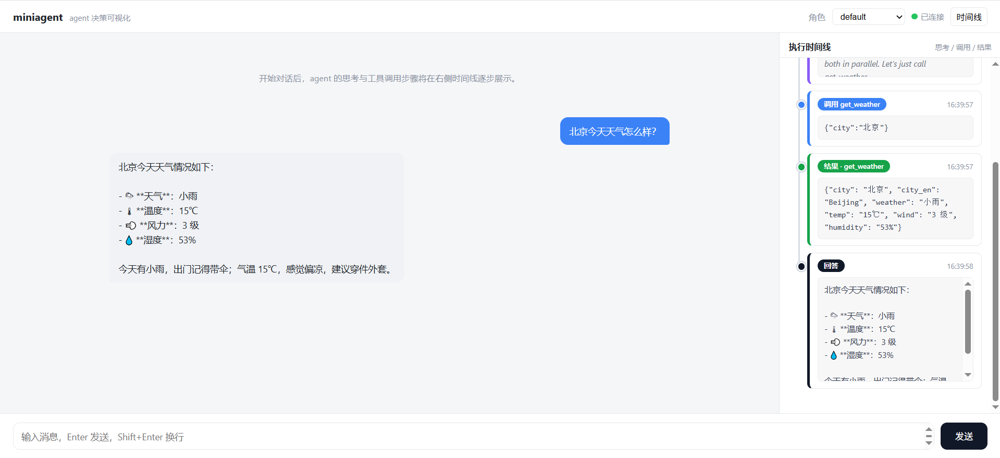
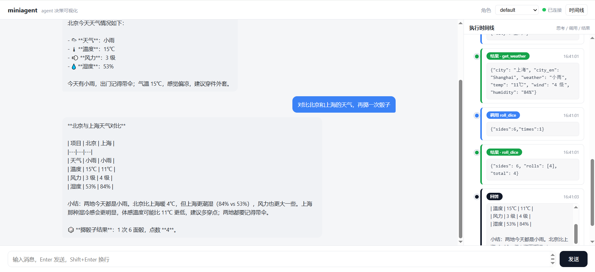
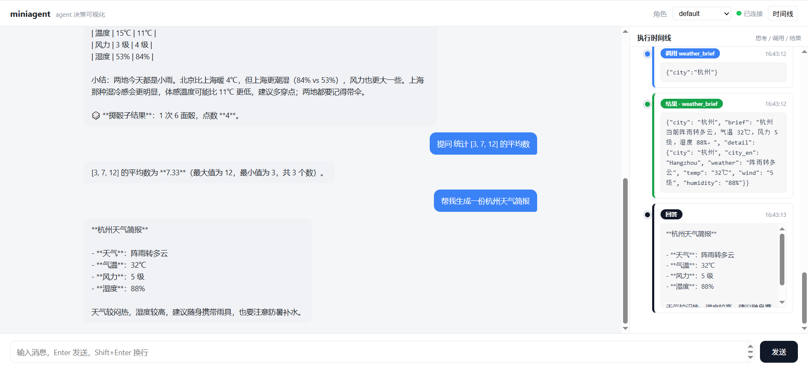
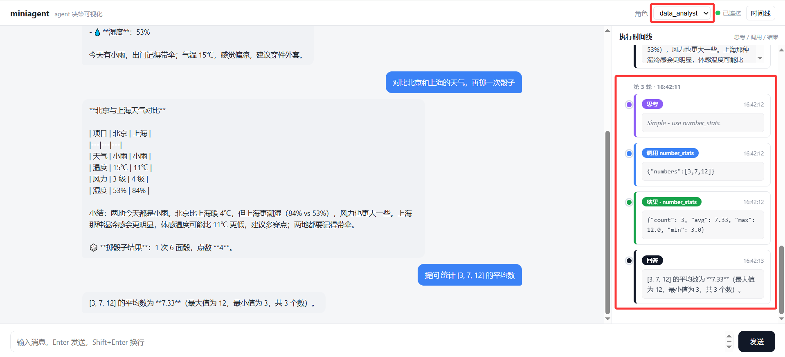
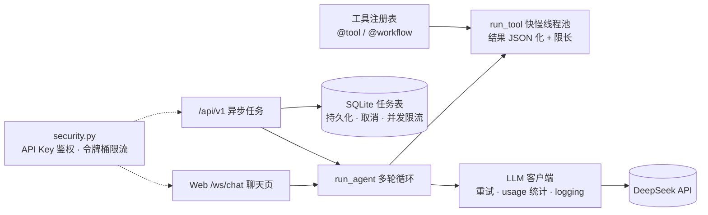
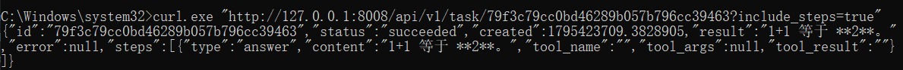

# miniagent

一个不依赖 langchain 的轻量 Python Agent 框架：基于 OpenAI SDK 接入 DeepSeek，提供**可视化对话页**（实时展示思考 / 工具调用 / 结果）、**工具与工作流编排**、**可对外服务的异步任务 API**（持久化、取消、鉴权、限流）。仓库内另含独立的 `CdpTools`（CDP 网页自动化）。

| 目录 | 说明 |
|---|---|
| `agent/` | 函数调用型 Agent 主体（FastAPI 服务 + WebSocket 聊天 + `/api/v1` 异步接口） |
| `CdpTools/` | 基于 Chrome DevTools Protocol 的网页元素拾取 + 流程编排 + 多进程执行工具 |
| `demo/` | 零依赖演示工具与工作流，用于展示前端执行流程（见 [demo/README.md](demo/README.md)） |

## 特性

- **多轮工具编排**：`@tool` 装饰器从类型注解自动生成 Schema；LLM 自主决定调用与顺序
- **可视化执行时间线**：思考（流式）、调用、结果、回答四类步骤实时推送
- **任务持久化**：`/api/v1` 任务落 SQLite，进程重启不丢；支持协作式取消
- **服务安全**：API Key 鉴权 + 令牌桶限流 + 工具可见性过滤（`public` 元数据）
- **LLM 韧性**：指数退避重试、token usage 统计、全链路 logging
- **上下文管理**：字符预算滑动窗口裁剪 + 可选摘要压缩，tool 消息配对完整

## 界面预览

以下截图由 `demo/` 演示流程产生（演示台词与截图清单见 [demo/README.md](demo/README.md)）。

| 主界面 | 执行时间线 |
|---|---|
|  |  |

| 工作流执行 | 角色切换 |
|---|---|
|  |  |

## 架构



## 快速开始

### 环境要求

- Python 3.12
- `CdpTools` 的捕获器需要图形界面，浏览器需 Chrome / Edge（只用 agent 可忽略）

### 安装

```bash
# Windows
python -m venv miniagt
miniagt\Scripts\activate
pip install -r requirements.txt

# macOS / Linux
python3 -m venv miniagt
source miniagt/bin/activate
pip install -r requirements.txt
```

### 配置密钥

复制 `agent/.env.example` 为 `agent/.env` 并填写（该文件已被 `.gitignore` 忽略，不要提交）：

```ini
API_KEY=sk-xxxxxxxxxxxxxxxx
DS_URL=https://api.deepseek.com

# 对外服务安全（可选）
AGENT_API_KEY=              # 配置后 /api/v1 与 /ws/chat 需携带此 key；留空 = 开发模式放行
AGENT_RATE_LIMIT_PER_MIN=20 # 每 caller 每分钟请求数上限
AGENT_INTENT_ROUTING=0      # 1 = 启用意图路由到工作流
```

### 运行

```bash
python main.py            # 生产入口
python demo/start_demo.py # 演示入口：额外注册 demo 工具/工作流
```

启动后访问 <http://127.0.0.1:8008>：网页内可切换角色、对话，并在右侧时间线实时查看 agent 的思考、工具调用与执行结果。

## agent：函数调用型 Agent

### 目录结构

```
miniagent/
├── agent/                      # Agent 主体（Python 包，相对导入）
│   ├── agent_tools/
│   │   ├── build_tools.py      # @tool 装饰器 + Schema 自动生成 + 注册（public/required 元数据）
│   │   └── command_exec.py     # 执行 shell 命令（本地示例，未注册进工具表）
│   ├── dbase/
│   │   └── db_query.py         # SQLAlchemy 通用查询工具（标识符校验 + 参数绑定 + 行数限量）
│   ├── workflows/
│   │   ├── registry.py         # @workflow 注册 + run_workflow 调度
│   │   └── demo_workflow.py    # 示例工作流（text_upper / text_stats）
│   ├── llm/
│   │   ├── agent.py            # LLM 客户端：流式调用、重试、usage、system_msg(role)
│   │   ├── agent_loop.py       # AgentStep + run_agent 多轮循环（取消 / 摘要压缩）
│   │   ├── context.py          # 上下文裁剪：字符预算滑动窗口 + 可选摘要
│   │   ├── intent.py           # 意图识别：LLM 分类 + 工作流路由
│   │   └── prompts.py          # Prompt 角色库
│   ├── task/
│   │   └── runner.py           # 工具执行器：快慢池分流 + 超时 + 结果标准化
│   ├── web/
│   │   ├── app.py              # FastAPI：WS /ws/chat + 静态聊天页
│   │   └── static/             # 前端页面（原生 HTML/JS/CSS）
│   ├── service/
│   │   ├── async_api.py        # /api/v1/*：提交 / 查询 / 取消
│   │   ├── task_store.py       # 任务 SQLite 存取层
│   │   └── security.py         # API Key 鉴权 + 令牌桶限流
│   ├── .env                    # 密钥（已被 git 忽略，不入仓）
│   └── .env.example            # 密钥模板（只写键名）
├── demo/                       # 演示工具与工作流（零外部依赖）
├── tests/                      # 单元测试与服务冒烟测试
├── docs/                       # 项目说明书与截图
├── main.py                     # 统一入口：python main.py
├── CdpTools/                   # CDP 工具（详见 CdpTools/README.md）
└── requirements.txt
```

### 模块一览

| 模块 | 作用 |
|---|---|
| `agent_tools/build_tools.py` | `@tool` 装饰器：从类型注解自动生成 function-calling Schema 并注册；`get_tools(include_private=...)` / `get_registry()` |
| `dbase/db_query.py` | `query_database(db_url, table, fields, filters, limit)` 通用查询，`@tool` 注册，标识符校验 + 参数绑定 + 行数限量 |
| `workflows/` | `@workflow` 注册短固定工作流，`run_workflow(name, **kwargs)` 统一调度；自动包装为慢工具（300s 超时） |
| `llm/agent_loop.py` | `run_agent()` 多轮循环：流式输出 → 解析 tool_calls → 执行 → 回填；参数错误回填重试；协作式取消（`cancel_event`） |
| `llm/context.py` | `trim_messages()` 字符预算裁剪（默认 30000），保证 tool 配对；`summarize_fn` 摘要压缩开关 |
| `llm/intent.py` | `detect_intent(text, client)` 意图分类；`route_to_workflow()` 按置信度路由到工作流 |
| `task/runner.py` | 快/慢线程池分流执行 + 超时 + `normalize_result()`（JSON 化 + 6000 字符限长） |
| `web/app.py` | 聊天页 + `WS /ws/chat`（握手鉴权 + 限流）+ `GET /roles`、`/workflows` |
| `service/async_api.py` | `POST /api/v1/chat` 提交、`GET /api/v1/task/{id}` 查询、`POST /api/v1/task/{id}/cancel` 取消 |
| `service/task_store.py` | 任务 SQLite 存取（重启不丢，清理只淘汰终态任务） |
| `service/security.py` | API Key 鉴权依赖 + 内存令牌桶限流（/api/v1 与 /ws/chat 共用） |

### 对外接口

```bash
# macOS / Linux
curl -X POST http://127.0.0.1:8008/api/v1/chat \
     -H "Content-Type: application/json" \
     -d '{"message": "1+1 等于几", "role": "default"}'
# → {"task_id": "...", "status": "queued"}
```

```powershell
# Windows PowerShell（中文消息需显式 UTF-8 编码）
$body = [System.Text.Encoding]::UTF8.GetBytes('{"message": "1+1 等于几", "role": "default"}')
$resp = Invoke-RestMethod -Uri "http://127.0.0.1:8008/api/v1/chat" -Method Post `
        -ContentType "application/json" -Body $body

# 查询结果；include_steps=true 附带全部执行步骤
Invoke-RestMethod -Uri "http://127.0.0.1:8008/api/v1/task/$($resp.task_id)?include_steps=true"

# 取消任务（协作式：运行中的单个工具无法强杀，轮间退出）
Invoke-RestMethod -Uri "http://127.0.0.1:8008/api/v1/task/$($resp.task_id)/cancel" -Method Post
```

> 注意：PowerShell 里 `curl` 是 `Invoke-WebRequest` 的别名，不接受 `-X/-H/-d` 参数；
> 想用 Unix 风格请写 `curl.exe`。

鉴权与限流（`AGENT_API_KEY` 配置后生效）：

```bash
curl -X POST http://127.0.0.1:8008/api/v1/chat \
     -H "X-API-Key: <你的key>" -H "Content-Type: application/json" \
     -d '{"message": "...", "role": "default"}'
```

```powershell
Invoke-RestMethod -Uri "http://127.0.0.1:8008/api/v1/chat" -Method Post `
    -Headers @{ "X-API-Key" = "你的key" } -ContentType "application/json" `
    -Body ([System.Text.Encoding]::UTF8.GetBytes('{"message": "...", "role": "default"}'))
```

WebSocket：连接 `ws://127.0.0.1:8008/ws/chat`，发送 `{"message": "...", "role": "default"}`，逐条接收 `{"type": "step", "step": {...}}`，最终收到 `{"type": "done", "content": "..."}`（或 `{"type": "error", ...}`）。步骤 `step.type` 为 `reasoning / tool_call / tool_result / answer`。

异步任务查询响应（含完整执行步骤）：



### 测试

```bash
python -m unittest discover -s tests -p "test_*.py"   # 全部单元测试（无需密钥）
python tests/test_phase4_6_smoke.py                   # 服务冒烟测试（自动起停）
```

### 当前进度

- [x] 工具 Schema 自动生成与注册（含 `public` 可见性元数据）
- [x] LLM 客户端与多轮对话（指数退避重试 + usage 统计 + logging + 协作式取消）
- [x] 通用数据库查询工具（`agent/dbase`）
- [x] 工作流注册与示例（`agent/workflows`）
- [x] Prompt 角色库与 `system_msg(role)` 切换
- [x] Web 可视化对话页（`agent/web`）
- [x] 对外异步服务接口（`agent/service`）：SQLite 持久化 + 取消 + 并发上限 + 鉴权限流
- [x] 上下文管理：字符预算裁剪 + 可选摘要压缩（`summarizer` 参数）
- [x] 意图识别真实实现（`AGENT_INTENT_ROUTING=1` 启用路由）
- [ ] 前端逻辑测试与 CI

## demo：前端演示

`demo/` 提供一组零外部依赖的演示工具（模拟天气、掷骰子、数字统计）与演示工作流（`weather_brief`），
按 [demo/README.md](demo/README.md) 的演示台词提问，即可在时间线上完整展示
**思考 → 调用 → 结果 → 回答** 的全流程：

```bash
python demo/start_demo.py
# 试试输入：对比北京和上海的天气，再掷一次骰子
```

## CdpTools

基于 CDP 做网页自动化，不写 CSS/XPath、不依赖 Selenium：用捕获器在浏览器里点选元素，存成 JSON 元素库，脚本里按「分组 + 元素名」操作元素。

```bash
python CdpTools/capture/element_capture_qt.py   # 1. 捕获元素，保存为元素库 JSON
python CdpTools/examples/run_parallel.py --list # 2. 查看示例任务
```

```python
from cdp_flow import Browser

browser = Browser.launch(port=9222, library="CdpTools/examples/demo_lib.json")
tab = browser.new_tab("https://example.com/")
tab.group("demo").element("search_input").input_text("hello")
```

完整说明（元素库格式、API 速查、多进程规则、常见问题）见 [`CdpTools/README.md`](CdpTools/README.md)。

## 更新日志

### 2026.11.23 文档与演示

- README 重构：特性速览、架构图、界面预览占位、目录结构更新
- 新增 `demo/`：演示工具与工作流 + 演示台词脚本 + 截图清单

### 2026.11.17 P1/P2：从开发自用升级为可对外服务

- **任务持久化**：`/api/v1` 任务落 SQLite（`agent/data/tasks.db`），重启不丢；清理只淘汰终态任务
- **任务取消与并发控制**：新增 `POST /api/v1/task/{id}/cancel`（协作式取消）；信号量限同时执行 4 个任务；修复异步任务可能被垃圾回收的问题
- **鉴权与限流**：配置 `AGENT_API_KEY` 后 `/api/v1` 与 `/ws/chat` 强制校验（未配置 = 开发模式放行）；令牌桶限流默认 20 次/分钟，超限 401/429
- **LLM 韧性**：调用失败指数退避重试（3 次）；token usage 统计；全链路 logging
- **循环健壮性**：工具参数解析失败/必填缺失回填结构化错误让模型重试；达到轮数上限时优先返回已有结论
- **上下文摘要压缩**：`run_agent(summarizer=...)` 可选，被裁历史压缩为记忆保留（默认关闭）
- **意图路由**：`AGENT_INTENT_ROUTING=1` 启用，命中工作流时缩小工具集（默认关闭）
- **工具可见性**：`@tool(public=False)` 私有工具机制；`tests/` 修复 gitignore 误忽略

### 2026.11.09 P0：可靠性基础

- 工具结果标准化：统一 JSON 输出 + 6000 字符限长截断（`agent/task/runner.py`）
- 上下文长度管理：字符预算滑动窗口裁剪，保证 tool 消息配对完整（`agent/llm/context.py`）
